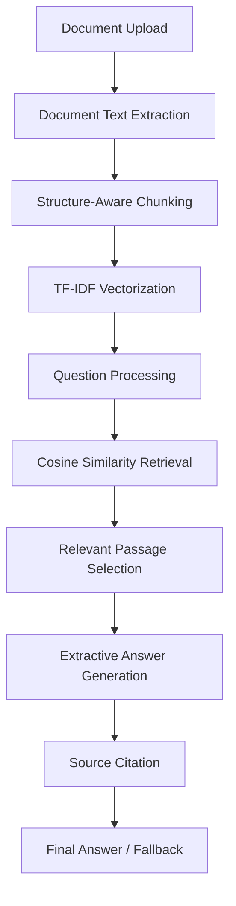

# Document Question-Answering Assistant

<p align="center">
    <strong>CodeNova AI/ML Internship | Task 4</strong><br>
    A local, source-grounded assistant for asking questions about uploaded documents.
</p>

<p align="center">
    
    
    
    
    
    
</p>

## Contents

- [Overview](#overview)
- [Features](#features)
- [Technology stack](#technology-stack)
- [Architecture](#architecture)
- [Workflow](#workflow)
- [Supported documents](#supported-documents)
- [Project structure](#project-structure)
- [Quick start on Windows](#quick-start-on-windows)
- [Sample corpus and questions](#sample-corpus-and-questions)
- [Testing](#testing)
- [Limitations and future improvements](#limitations-and-future-improvements)
- [Acknowledgements](#acknowledgements)

## Overview

Finding one reliable fact inside a long policy, guide, or report is often slower than reading the document itself. This project provides a small, transparent retrieval-augmented question-answering workflow that runs entirely on the local machine.

Users can enable the included sample corpus, upload PDF/DOCX/TXT/Markdown files, and ask questions in the Streamlit interface. The application retrieves relevant passages, selects supporting sentences directly from those passages, and displays source citations. It does not use an LLM, neural embeddings, generative model, paid API, or external network call for answering.

When the indexed documents do not provide enough evidence, the answer is exactly:

> `Information not found in provided document`

## Features

- **Local document ingestion:** Load PDF, DOCX, TXT, and Markdown files.
- **Source-aware indexing:** Preserve filenames plus PDF page or text/DOCX paragraph locations.
- **Structure-aware chunking:** Split on sentence boundaries, group within a word limit, and retain a small overlap.
- **Classical information retrieval:** Use TF-IDF word unigrams and bigrams with cosine similarity.
- **Extractive answers:** Return sentences copied from the indexed documents rather than generating unsupported facts.
- **Citations and evidence:** Show source filename, location, chunk number, and the supporting passage.
- **Explicit uncertainty:** Apply relevance and query-term coverage checks before returning an answer.
- **Simple local UI:** Upload multiple files or include the bundled sample documents from the sidebar.

## Technology stack

| Component | Role |
| --- | --- |
| Python | Application and pipeline implementation |
| Streamlit | Local interactive web interface |
| scikit-learn | `TfidfVectorizer` and cosine similarity |
| pypdf | Text extraction from PDF pages |
| python-docx | Text extraction from DOCX paragraphs and tables |
| Regular expressions | Text cleanup and lightweight sentence splitting |
| `unittest` | Automated QA-engine tests |

## Architecture



The same flow in compact form:

```text
Document Upload -> Text Extraction -> Structure-Aware Chunking
-> TF-IDF Vectorization -> Question Processing -> Cosine Similarity Retrieval
-> Relevant Passage Selection -> Extractive Answer Generation
-> Source Citation -> Final Answer / Fallback
```

## Workflow

### 1. Document ingestion and text extraction

`src/document_loader.py` detects the file extension and extracts readable text:

- **PDF:** `pypdf` reads each page and records its page number.
- **DOCX:** `python-docx` reads non-empty paragraphs and table rows, recording a paragraph-like sequence number.
- **TXT/Markdown:** UTF-8 with BOM is preferred, with Windows `cp1252` fallback; blank-line-separated blocks become source segments.

Text is normalized by removing null characters, standardizing line endings, collapsing repeated spaces, and trimming excessive blank lines. Empty or unreadable files raise an error instead of entering the index. Scanned image-only PDFs are not OCR processed.

### 2. Structure-aware chunking

`src/chunking.py` uses a lightweight sentence splitter that requires no downloaded language model. Sentences are grouped into chunks of up to 110 words by default, with up to 20 words of sentence-level overlap between adjacent chunks. Source and PDF page boundaries are respected, and paragraph IDs are retained for citations.

This is structure-aware rather than embedding-based semantic chunking: it keeps complete sentences where possible and groups nearby source paragraphs without crossing a page boundary. Long individual sentences are split into bounded word segments.

### 3. TF-IDF vectorization

`DocumentQA` creates a local sparse representation with scikit-learn's `TfidfVectorizer`:

- lowercase normalization;
- English stop-word removal;
- word unigrams and bigrams (`ngram_range=(1, 2)`);
- sublinear term frequency;
- up to 50,000 features.

No document text is sent to a hosted model or API.

### 4. Question processing and retrieval

The question is transformed using the same vectorizer as the chunks. Cosine similarity ranks the indexed chunks. The engine also calculates non-stopword query-term coverage and combines the two signals:

```text
relevance = 0.70 * cosine_similarity + 0.30 * query_term_coverage
```

The best chunk must pass both the minimum relevance threshold (`0.10` by default) and a minimum coverage gate. Up to four top-ranked chunks are then considered for sentence selection.

### 5. Extractive answer selection and citation

Candidate sentences are scored against the question using cosine similarity and query-term coverage. The engine selects up to three distinct high-scoring sentences and returns them verbatim. Each selected sentence receives a citation such as:

```text
library_policy.txt | paragraphs 1–3 | chunk 1
```

The interface also displays the complete supporting chunk in an expandable passage panel. The displayed relevance value is a retrieval heuristic, not a probability or calibrated confidence score.

### 6. Unsupported-question fallback

The engine returns the required fallback when the question is blank, contains no terms recognized by the vectorizer, has insufficient chunk-level evidence, or produces no sentence with meaningful overlap:

```text
Information not found in provided document
```

For fallback results, citations and supporting passages are empty. This prevents a weak lexical match from being presented as a grounded answer.

## Supported documents

The Streamlit uploader accepts `.pdf`, `.docx`, `.txt`, and `.md` files. Multiple files can be uploaded at once. Sample documents are enabled by default, and the sidebar checkbox can disable them when only uploaded files should be searched.

The application is local, but users should still upload only documents they are permitted to process. PDF extraction depends on an actual text layer; OCR is a future improvement.

## Project structure

```text
Task_4_RAG/
├── app.py                         # Streamlit interface and document selection
├── requirements.txt               # Runtime dependencies
├── README.md                      # Project documentation
├── .gitignore
├── .streamlit/
│   └── config.toml                # Local Streamlit configuration
├── src/
│   ├── __init__.py
│   ├── document_loader.py          # PDF, DOCX, TXT, and Markdown ingestion
│   ├── chunking.py                 # Sentence/paragraph-aware chunking
│   └── qa_engine.py                # TF-IDF retrieval and extractive QA
├── data/
│   └── sample_corpus/
│       ├── campus_it_guide.txt
│       └── library_policy.txt
├── docs/
│   └── sample_transcripts.md       # Demonstration transcript artifact
└── tests/
        └── test_qa_engine.py           # Three unittest cases
```

## Quick start on Windows

Open PowerShell in the project root:

```powershell
py -m venv .venv

.\.venv\Scripts\Activate.ps1

pip install -r requirements.txt

streamlit run app.py
```

If PowerShell blocks activation for the current process, use:

```powershell
Set-ExecutionPolicy -Scope Process -ExecutionPolicy RemoteSigned
```

Then activate the environment and run the commands above. Streamlit opens the local application in a browser. The sample documents are loaded by default; uploaded documents can be added from the sidebar.

## Sample corpus and questions

The checked-in corpus contains two text documents about **Ideal Institute of Engineering (IIE), Kalyani**:

| File | Verified subject matter |
| --- | --- |
| `library_policy.txt` | Library collection, reading/lending sections, J-GATE, DELNET, KOHA catalogue software, older disclosed hours, and details that must be confirmed with library staff. |
| `campus_it_guide.txt` | Publicly described Wi-Fi and smart-classroom facilities, general technical-issue reporting guidance, safe credential handling, and operational details not published on the public website. |

Supported examples from these files include:

| Question | Expected behavior |
| --- | --- |
| What is the IIE library's catalogue management software? | Supported; the document names **KOHA**. |
| Which digital library resources are available at IIE? | Supported; the document names **J-GATE** and **DELNET**. |
| What facilities does the IIE campus provide? | Supported; the IT guide describes high-speed Wi-Fi, smart classrooms, interactive smart boards, LCD projectors, and advanced laboratories. |
| How can a student get help with campus IT problems? | Partially supported; the guide says to contact the appropriate department office or institute staff and use the published general institute channels. It does not identify a dedicated IT help desk. |
| What is the college parking fee? | Unsupported; the fallback should be returned. |
| What is the current library borrowing limit or exact loan period? | Unsupported by the current public-information summary; the document says these details must be confirmed with the library. |

The file [`docs/sample_transcripts.md`](docs/sample_transcripts.md) is present as a documentation artifact, but its example answers refer to an older Green Valley College dataset and do not match the current IIE sample corpus. The current corpus is the source of truth for the examples above.

## Testing

Run the included tests from the project root:

```powershell
python -m unittest discover -s tests -v
```

`tests/test_qa_engine.py` covers:

- a supported library question returning an answer and a source citation;
- an unsupported parking-fee question returning the exact fallback;
- an empty question returning the exact fallback.

### Test result in the current environment

The command was run during documentation review with both available interpreters:

- **System Python:** test discovery stopped during import because scikit-learn was not installed (`ModuleNotFoundError: No module named 'sklearn'`).
- **Project virtual environment:** 2 tests passed and 1 test failed. The failing test expects `14 days`, but the current `library_policy.txt` explicitly says that the borrowing period is not published and must be confirmed with the library.

This exposes a stale test expectation in `tests/test_qa_engine.py`, not a missing dependency in the project environment. The README intentionally does not repeat the outdated borrowing claim as a verified sample answer.

## Limitations and future improvements

- **Lexical retrieval:** TF-IDF depends on word overlap and may miss paraphrases, synonyms, or multi-hop questions.
- **Heuristic threshold:** Relevance and coverage thresholds are hand-tuned retrieval gates, not calibrated confidence estimates.
- **No OCR:** Image-only or scanned PDFs require OCR before ingestion.
- **Lightweight sentence splitting:** Abbreviations, complex punctuation, headers, footers, and multi-column layouts may split imperfectly.
- **No generative synthesis:** Answers are extractive, so the system cannot summarize or combine evidence in newly generated prose.
- **Limited evaluation set:** The current tests are focused smoke tests; a larger labelled question set should measure answer-support rate, Recall@k, and MRR.

Potential next steps include OCR support, stronger PDF layout handling, table extraction, BM25 comparison, optional free local embedding retrieval, and a larger evaluation dataset.

## Acknowledgements

Built for the **CodeNova AI/ML Internship, Task 4** using open-source Python tooling. The sample corpus is included for demonstration and should not be treated as a complete or current institutional policy. Operational details such as current library hours, borrowing rules, Wi-Fi credentials, and support procedures should be verified with the relevant IIE office before use.
